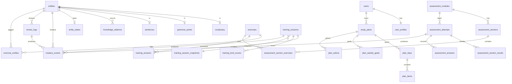

# 统一学习数据模型（第二阶段 · 2.1）

> 前置：`BUSINESS_MODEL_REVIEW.md`（现状问题与缺口）。
> 本文定义**目标模型**：实体、职责、键、关系、生命周期，以及五条写入路径的数据流转。
> 表级 DDL、索引、约束、事务与备份见 `DATABASE_DESIGN.md`；分层与线程模型见 `RUST_DATABASE_ARCHITECTURE.md`。
> 本文不引入新业务功能，只把已存在的业务事实**收敛成单一事实源**。

---

## 1. 六层分层（唯一的结构性原则）

所有数据必须能明确归入下面六层之一。**判断标准：这条记录能否由其它数据重算出来？能 → 不是事实，不进库。**

| 层 | 语义 | 例子 | 写入方式 | 可重算 |
|---|---|---|---|---|
| L1 内容 | 学习材料本身（与用户无关） | `entities`、`vocabulary`、`grammar_points`、`sentences`、`knowledge_relations`、`exercises`、`assessment_*`、`training_options` | 内容包同步（幂等 UPSERT） | 否（是外部输入） |
| L2 身份 | 谁在用、偏好是什么 | `users`、`user_profiles`、`app_settings` | 用户操作 | 否 |
| L3 学习态 | **此刻**该知识点的掌握与调度 | `entity_states` | 事件驱动更新 | 是（可由事件重放，但保留以避免全量重算） |
| L4 事件 | 发生过什么（只追加） | `training_sessions` + `training_answers`、`assessment_attempts` + 子表、`review_logs`、`mastery_events` | 事务内 INSERT，永不 UPDATE | **否，不可重算**（是事实源头） |
| L5 计划 | 对未来行为的承诺 | `study_plans` + `plan_days` + `plan_items` + `plan_weekly_goals` + `plan_advice` | 生成 + 局部修改（done） | 计划内容可重生成，但**已生成版本要保留** |
| L6 派生 | 只读视图/接口返回值 | 日统计、周统计、连击、正确率、掌握度分布、趋势、遗忘曲线、复习队列、画像、完成率 | **不落库**，查询时计算 | 是 |

### 1.1 三条硬规则

- **规则 1（单一事实源）**：同一事实只能有一个 L4 写入点。当前 `mastery_events` 由训练、测评写入，2.3 阶段加入复习后也只有这三条路径，且统一经过 `state_updater`。
- **规则 2（状态可由事件推导）**：`entity_states` 的每个字段都必须能从 `training_answers` / `assessment_answers` / `review_logs` 重放得到。做不到的字段说明它其实是事实，应搬到 L4。
- **规则 3（派生不落库）**：`score`、`accuracy`、`xp`、`completion`、`streak`、`avgMastery` 一律现算。允许为性能做**物化**，但必须能一键重建，且只有唯一写入点。

---

## 2. 实体定义

字段只列**业务字段**，审计字段（`created_at`/`updated_at`）省略。

### 2.1 L2 身份

| 实体 | 职责 | 主键 | 外键 | 基数 | 层 | 可重算 |
|---|---|---|---|---|---|---|
| `User` | 账号身份；V2 只有本地单用户 | `id`（`u_local_01`） | — | 1 | L2 | 否 |
| `UserProfile` | 学习目标、等级、时区、每日预算 | `user_id` | → `users.id` | 1:1 | L2 | 否（用户输入） |
| `AppSettings` | 点分键值（外观/提醒/学习偏好） | `key` | — | N:1 用户（逻辑） | L2 | 否 |

> 保留 `users` / `user_profiles` 拆分：未来引入多用户或云同步时，账号与画像的生命周期不同（Q6 已确认）。

### 2.2 L1 内容

| 实体 | 职责 | 主键 | 外键 | 基数 | 说明 |
|---|---|---|---|---|---|
| `KnowledgeEntity` | 知识实体身份 + 分类（word/phrase/grammar/sentence）+ 难度/等级 | `id` | — | 1 | **只存身份与分类**，不存学习态 |
| `Vocabulary` / `GrammarPoint` / `Sentence` | 实体正文（1:1 扩展表） | `entity_id` | → `entities.id` | 1:1 | 与实体分表，避免稀疏宽表 |
| `WordMeaning` / `WordExample` / `GrammarExample` / `GrammarMistake` | 明细（一对多） | 自增 / `id` | → 父表 | 1:N | 有序用 `sort_order` + UNIQUE |
| `KnowledgeRelation` | 实体间有向关系（图/邻居/关联） | 自增 | `source_id`,`target_id` → `entities` | N:M | 关系是一等公民，不再摊成 id 数组 |
| `Exercise` | 题目；题型专有字段放 `payload_json` | `id` | — | 1 | 判分由服务端读 payload |
| `ExerciseEntity` | 题 → 知识点（掌握度回写依据） | (`exercise_id`,`entity_id`) | 双外键 | N:M | 必填，缺它则该题不影响掌握度 |
| `TrainingOption` | 训练入口元数据 | `id` | — | 1 | 卡片展示；`kind` 应唯一 |
| `AssessmentModule` / `AssessmentSection` / `AssessmentSectionExercise` | 测评结构树 | 各自 id / 复合键 | 逐级 FK | 1:N / N:M | 见 §6.3 空分项语义 |

### 2.3 L3 学习态

| 实体 | 职责 | 主键 | 外键 | 基数 | 可重算 |
|---|---|---|---|---|---|
| `EntityState` | 单个知识点的**当前**掌握度与调度状态 | `entity_id` | → `entities.id` | 1:1（可能缺行=未学） | 是（事件重放） |

字段语义（`mastery` 0–100、`strength` 0–1、`state` new/learning/reviewing/mastered）：

| 字段组 | 字段 | 来源 | 备注 |
|---|---|---|---|
| 掌握 | `mastery`、`strength`、`state` | `mastery::update_mastery` | `state` 由 `mastery` 阈值派生，可重算 |
| 调度（= ReviewSchedule） | `due_at`、`interval_days`、`ease`、`repetition` | `srs::schedule_next` | **不是独立实体**，就是 `entity_states` 的列 |
| 计数 | `review_count`、`lapse_count` | 事件计数 | `lapse_count` 目前双算：`mastery::Update.lapse_count`（`algorithms/mastery.rs:129`）被丢弃，最终写 `srs` 的结果（`state_updater.rs:54`）→ **必须只由 SRS 产出** |
| 溯源 | `last_reviewed_at`、`updated_at` | 最近一次事件 | — |
| 并发 | `row_version` | 每次写 +1 | 必须真正参与 CAS，否则删除该列 |

> **`kind` 是否保留在 `entity_states`**：保留（读优化），但只能由服务端从 `entities` 复制，写入路径唯一，客户端不得传。

### 2.4 L4 事件

| 实体 | 职责 | 主键 | 外键 | 基数 | 快照策略 |
|---|---|---|---|---|---|
| `TrainingSession` | 一次训练的事实：成绩、时长、XP | `id` | `session_snapshot_id` → 快照 | 1:N 于用户 | 存**题目集合与难度**快照，见 §5.2 |
| `TrainingAnswer` | 逐题作答与判分结果 | 自增 | `session_id`；`exercise_id`（**应加 FK**） | N:1 | 存 `value_json` + `correct` + `partial_score` |
| `TrainingKindScore` | 按题型小计 | (`session_id`,`kind`) | `session_id` | N:1 | **可派生**，建议降级为视图 |
| `AssessmentAttempt` | 一次测评的事实 + 画像快照 | `id` | `module_id` | 1:N | 存 `strengths/weaknesses/recommendation`（当时排名） |
| `AssessmentSectionResult` | 分项成绩 | (`attempt_id`,`section_id`) | `attempt_id`；`section_id`（**应加 FK**） | N:1 | 存 `title` 快照（内容改名不影响历史） |
| `AssessmentAnswer` | 测评逐题作答 | 自增 | `attempt_id`；`exercise_id`（**应加 FK**） | N:1 | 同训练 |
| `ReviewLog` | 一次复习的调度事实 | `id` | `entity_id`；`submission_id` UNIQUE | N:1 | 存 `prev/next due`、`prev/next interval`、`ease`、`mastery before/after`、`xp` |
| `MasteryEvent` | 掌握度变化账本（跨来源） | `id` | `entity_id`；`ref_id`（**软引用，见下**） | N:1 | 存 `before/after/source/ref_id` |

**`MasteryEvent` 的定位**：它不是"另一种历史"，而是**统一时间轴**。`source ∈ {training, assessment, review}`，`ref_id` 指向对应事实表主键（`training_sessions.id` / `assessment_attempts.id` / `review_logs.id`）。

> `ref_id` 不加外键的理由：它多态指向三张表，SQLite 无法表达；改用 `(source, ref_id)` 复合索引 + 应用层校验。**这是全模型唯一允许的"无物理外键"引用**，必须在 Repository 层集中校验。

### 2.5 L5 计划

| 实体 | 职责 | 主键 | 外键 | 基数 |
|---|---|---|---|---|
| `StudyPlan` | 一个计划版本（可迭代，旧版本 `superseded_at` 标记） | `id` | — | N:1 用户（仅 1 个 `active`） |
| `PlanDay` | 计划中的一天 | `id` | `plan_id` | N:1 |
| `PlanItem` | 一天中的一项任务 | `id` | `plan_day_id` | N:1 |
| `PlanWeeklyGoal` | 周目标 | `id` | `plan_id` | N:1 |
| `PlanAdvice` | 建议卡（含证据） | `id` | `plan_id` | N:1 |

**关键决定**
- 计划保留**版本**：`status ∈ {active, superseded}`，部分唯一索引保证最多一个 `active`。历史版本不删，便于"这周为什么这么排"的追溯。
- `PlanItem` 用 `status ∈ {pending, done, skipped}` **单字段**表达完成，删除 `done`（否则两个标志必然打架）。
- `PlanDay.date` 用 `YYYY-MM-DD`（本地日历日），不参与时区换算；其它时间一律 UTC ISO。

### 2.6 L6 派生（不建表，只定义）

| 视图 | 输入 | 输出 | 唯一实现位置（建议） |
|---|---|---|---|
| 复习队列 | `entity_states` where `due_at <= now` + 内容 | `ReviewQueueItem[]` | Rust `review_service::queue` |
| 学习记录（统一时间轴） | 三张事实表 UNION | `LearningRecord[]`（分页） | Rust 读模型 |
| 日/周统计 | `training_sessions` + `review_logs` | `DailyStat[]` / `WeeklyStat[]` | Rust `analytics` |
| 总量与正确率 | 同上 | `{minutes, accuracy, xp, streak}` | Rust `analytics`（**唯一口径**） |
| 掌握度分布 | `entity_states` + `entities.kind` | 四档计数 | 同上 |
| 掌握度趋势 | `mastery_events` 回放 | 时间序列 | 同上 |
| 遗忘曲线 | `entity_states.strength` + `interval_days` | 曲线点 | 同上 |
| 能力画像 | 最近 N 次事件 + 掌握度 | `AbilityProfile`（6 轴 + 等级） | Rust `ability`（前端只展示） |
| 计划完成率 | `plan_items` | `{done,total,rate}` | Rust（**禁止前端重算**） |

> `LearningRecord` 不是新表，是"三张事实表的投影"。加宽表会立刻把 L4 变成 L6，重蹈派生列落库的覆辙。

---

## 3. 实体关系（ER）



---

## 4. 五条写入路径（数据流转）

### 4.1 训练提交

```
client: { sessionId, answers:[{exerciseId, value, elapsedMs}] }
  → 事务(BEGIN IMMEDIATE)
     1. 幂等：UNIQUE(submission_id) 命中 → 直接返回既有结果
     2. 读快照 exercises_json（题目与答案的唯一来源，不信客户端）
     3. 判分 grading::score_answer，逐题得 (correct, partial)
     4. 写 training_sessions / training_answers / training_session_entities
     5. 对每个 (exercise → entity) 调 state_updater::apply_performance
          → UPDATE entity_states（同一实体一会话只写一次，聚合 partial）
          → INSERT mastery_events(source=training, ref_id=session_id)
     6. 标记快照 consumed_at（防二次签名）
     7. bump_revision，COMMIT
  → 返回 ExerciseResult（分数、xp、perKind 全部现算后返回，不落冗余列）
```

### 4.2 测评提交

```
client: { moduleId, submissionId(必填), answers:[...] }
  → 事务
     1. 幂等：UNIQUE(submission_id)
     2. 读模块结构（module→section→exercise，一次批量查询）
     3. 逐分项判分：total = 该分项题数；score = round(partial 均值 ×100)
        · total == 0 的分项：score=0 且**不参与总分**
     4. 总分 = 有题分项 score 的算术平均；level = ability::level_of_score
     5. strengths/weaknesses/recommendation **作为快照落库**
        （依赖当时排名，事后重算会变）
     6. 写 attempt / section_results（存 title 快照）/ answers
     7. 逐实体 update state + INSERT mastery_events(source=assessment)
     8. 计划：标记当日相关项（不做整份重排，见 2.4 阶段）
  → 返回 AssessmentOutcome（perSection 来自落库结果，followUp 现算）
```

### 4.3 复习提交（2.3 阶段补齐，当前仅前端）

```
client: { submissionId, items:[{ entityId, rating(again|hard|good|easy), elapsedMs }] }
  → 事务
     1. 幂等：review_logs.submission_id 唯一（部分索引已建）
     2. 逐条：
        · 读 entity_states（不存在则初始化 new）
        · schedule = srs::schedule_next(rating, state)   ← 唯一排期算法
        · mastery  = mastery::update_mastery(partial=rating 映射, state)
        · UPDATE entity_states（含 due_at/interval/ease/repetition/lapse_count）
        · INSERT review_logs（prev/next due、prev/next interval、ease、mastery before/after）
        · INSERT mastery_events(source=review, ref_id=review_log.id)
     3. 计划：只标记 sort_order 最小的未完成复习项（修 D10）
     4. 返回 ReviewSummary{ reviewed, remainingDue, nextDueAt }
```

### 4.4 计划生成/调整（2.4 阶段）

```
输入（全部来自 L3/L4，不读页面）：
  ability(最近 N 次事件 + entity_states)、dueCount、recentAccuracy(10)、
  weeklyMinutes/activeDays/newMastered、difficultyOverride、timezone
  → 规则引擎产出 PlanDraft（纯函数，可单测）
  → 事务：
     1. 旧 active 计划置 superseded（不删）
     2. INSERT study_plans(status=active, revision+1) + plan_days + plan_items + goals + advice
     3. 继承上一版"今日已完成项"（按 plan_item.id 或 (date,action) 精确匹配，不用 kind 模糊匹配）
  → 返回 StudyPlan（completion 由读模型现算）
```

### 4.5 内容包同步

```
启动 → 版本比对(app_metadata.content_pack_version)
  相同 → 跳过
  不同 → 事务：35 表 UPSERT（声明冲突键 + 列白名单校验）→ 写版本/校验和
  旧内容 → deprecated_at 软删除，不物理删除（保证历史 FAQ 可追溯）
```

---

## 5. 快照与不可变策略

### 5.1 哪些必须快照（用户当时看到的东西）

| 数据 | 为什么必须快照 | 现存实现 |
|---|---|---|
| 训练题目集合 + 难度 | 题库更新后仍要能复算当时的分数 | `training_session_snapshots.exercises_json`（已有） |
| 分项标题 | 内容改名不能改变历史成绩单的显示 | `assessment_section_results.title`（已有） |
| 测评 strengths/weaknesses/recommendation | 依赖当时排名，重算会变 | 已落库 |
| 复习的 prev/next due 与 interval | 证明调度是"按当时状态算的" | `review_logs` 已设计该列（当前零写入） |
| 掌握度 before/after | 趋势图精确回放 | `mastery_events` 已落库 |
| 计划版本 | 事后要能回答"这周为什么这么排" | `study_plans.status`（表已建，未接线） |

### 5.2 哪些绝对不能快照（会变陈旧）

- 知识点正文（`vocabulary` 等）→ 历史记录只存 `entity_id`，正文永远读最新内容。
- 当前掌握度 → 只有 `entity_states` 一份，其它表不得存副本（**这是当前最大的陈旧源**：内容实体上的 `mastery` 字段从不更新，见 `BUSINESS_MODEL_REVIEW.md` R3 / N17）。
- 完成率 / 统计 / 画像数值 → 现算。

### 5.3 删除与保留

| 对象 | 策略 |
|---|---|
| 内容实体 | 软删除（`entities.deprecated_at`），历史事件仍可 JOIN |
| 事件表 | **永不删除**（除非用户"清空本地数据"整体事务删除） |
| 计划 | 保留最近 5 版（`superseded_at` 排序后清理） |
| 备份文件 | 保留最近 10 份 |
| 内容删除后的历史 | 用 `title` 快照兜底显示，不因外键缺失而丢行 |

---

## 6. 三个跨模块契约

### 6.1 幂等键（`submission_key`）

统一为：**客户端生成 UUID，服务端强制要求，`UNIQUE` 约束兜底**。

| 路径 | 键 | 重复提交返回 |
|---|---|---|
| 训练 | `training_sessions.submission_id` | 既有 `ExerciseResult`（同一 payload） |
| 测评 | `assessment_attempts.submission_id` | 既有 `AssessmentOutcome` |
| 复习 | `review_logs.submission_id` | 既有 `ReviewSummary` |

禁止行为：用 `{module}_{now}` 之类的派生键（不可控、不幂等）。

### 6.2 时间模型

| 用途 | 表示 | 说明 |
|---|---|---|
| 事件时间戳 | UTC ISO8601 毫秒（`...Z`） | 定长、字典序即时间序 |
| 计划日期 | `YYYY-MM-DD`（用户本地日） | 不参与时区换算 |
| 跨层传递 | **只用字符串**，不传 epoch 毫秒 | 消除双轨（缺陷 R7） |
| 归日/统计分桶 | 服务端用 `profile.timezone` 换算 | 禁止 `new Date(iso).getHours()`；前端已统一走 `lib/date.ts` 的 `isoDateIn/hourIn/...`（2.2 ✅） |
| 比较/排序 | 字符串直接比较 | 定长格式保证正确 |

### 6.3 分项语义（含空分项）

`AssessmentSection` 增加**分支语义**，不再靠"有没有题"隐式推断：

| 语义 | 判定 | 判分行为 | UI 行为 |
|---|---|---|---|
| `graded`（可作答分项） | 有题目 | 正常判分，参与总分 | 逐步作答 |
| `summary`（汇总/评估分项） | 无题目，`kind='summary'`（或现存的 `roleplay` + 空题） | `score=0`，**不参与总分**，不产生 NaN | 显示"评估汇总"，不停留一步 |

→ `sec_speak_eval` 属于 `summary`，是合法数据；模型层用显式标记替代"空数组"这一脆弱约定。

---

## 7. 与现状的差异（实施时需要改的模型级变更）

| # | 变更 | 类型 | 兼容性 | 阶段 |
|---|---|---|---|---|
| M1 | 删除内容实体上的学习态字段（`Vocabulary.mastery` 等 6 个） | 前端类型 + 读模型组合 | 破坏性（需前端配合） | 2.2 ✅ |
| M2 | `review_logs` 接入写入路径 + 注册 `review_*` 命令 | 服务 + 命令 | 新增 | 2.3 |
| M3 | `mastery_events.source` 增加 `assessment`（前端类型/写入修正） | 契约 | 兼容（枚举扩展） | 2.2 ✅ |
| M4 | 统一 `submission_key` 必填 | 契约 | 破坏性（前端需生成） | 2.2 ✅ |
| M5 | 训练/测评的 `accuracy = score` 改为单一的"得分率"定义 | 派生口径 | 兼容 | 2.5 |
| M6 | `plan_items` 删 `done`，只留 `status` | 表结构 | 破坏性（需迁移） | 2.4 |
| M7 | 训练会话难度取快照值；`kind_scores` 降为视图 | 服务 + 表 | 兼容 | 2.5 |
| M8 | 五处缺失外键补齐（先清洗孤儿行） | 迁移 v2 | 破坏性数据修复 | 2.2 |
| M9 | `entity_states.row_version` 用于 CAS，或删除 | 服务 | 兼容 | 2.4 |
| M10 | 前端 `transport` 从"是否 Tauri"改为"按命令能力声明" | 契约层 | 兼容 | 2.2 |
| M11 | `assessment_sections` 增加 `section_role(graded/summary)` | 迁移 v2 + 内容包 | 兼容 | 2.2 ✅ |
| M12 | 时间统一为 ISO 字符串 + 归日按 `profile.timezone` | 服务 | 兼容 | 2.2 ✅ |

> 遗留：`algorithms/srs.ts` 的 `overdueDaysOf` 仍用本地日计算"逾期天数"，属展示口径；2.3 复习服务落地时统一改为按用户时区。

---

## 8. 一致性不变量（可写成测试）

| ID | 不变量 | 验证方式 |
|---|---|---|
| INV-1 | 每条 `training_answers` / `assessment_answers` 的 `exercise_id` 都能在 `exercises` 找到 | 集成测试 + 外键 |
| INV-2 | 每个 `mastery_events.ref_id` 在对应 `source` 表中存在 | Repository 校验测试 |
| INV-3 | `entity_states` 每个字段都能由事件重放得到（允许 1e-6 误差） | 重放测试 |
| INV-4 | `sum(plan_items where status=done) == 读模型 completion.done` | 读模型测试 |
| INV-5 | 任一 `submission_id` 重复提交，事件表行数不变 | 幂等测试（训练/测评已有，复习待补） |
| INV-6 | `due_at` 单调：同一实体的 `review_logs.next_due_at` 严格递增（除非 lapse） | SRS 单测 |
| INV-7 | 空分项 `score=0` 且不参与总分，总分永不为 NaN | 测评测试（已存在） |
| INV-8 | 同一事务内 `mastery_before` 等于上一次同实体的 `mastery_after` | 账本连续性测试 |

---

## 9. AI Core 边界（只定义接口，不实现）

### 9.1 定位

Sage 与 AI Core 是**两个独立仓库**。Sage 永远不直接调用模型、不写 Prompt、不做上下文记忆与 Agent 调度。

```
Sage（本仓）                    AI Core（独立仓）
  业务事实（SQLite）
     ↓ 导出只读快照                    ↓
  ai_context_build (Rust)  →  学习数据摘要 JSON  →
                                    规划/生成/建议推理
  ←  结构化输出 JSON  ←  校验（Schema + 业务规则）  ←
     ↓
  仅作为"候选方案"落库为 StudyPlan(status=draft)
```

### 9.2 AI 输入需要哪些学习数据（只导出派生读模型，不导原始表）

| 输入块 | 字段 | 来源 |
|---|---|---|
| 画像 | 6 轴能力分、等级、样本量、置信度 | L6 `ability` |
| 掌握分布 | 四档计数、按 kind 的平均掌握度 | L6 |
| 调度压力 | 到期数、逾期分布、未来 7 天预测到期 | L3 |
| 近期表现 | 最近 N 次事件（`at/kind/score/xp`），不含题目原文 | L4 投影 |
| 计划上下文 | 当前 active 计划的 `revision`、周目标 | L5 |
| 目标与偏好 | 每日预算、难度覆盖、考试日期 | L2 |
| 内容可用量 | 各 kind 的可选题量、词库规模 | L1 计数 |

**禁止导出**：完整题库原文、其他用户数据、设备信息。

### 9.3 AI 输出结构（草案）

```jsonc
{
  "schemaVersion": 1,
  "producedAt": "2026-11-14T12:00:00.000Z",
  "model": "ai-core/x.y",
  "kind": "study_plan",          // study_plan | advice | item_generation
  "confidence": 0.0,
  "plan": {
    "idempotencyKey": "uuid",     // Sage 侧据此去重
    "days": [
      {
        "date": "2026-11-15",
        "focus": "现在完成时",
        "items": [
          { "title": "...", "activity": "training", "minutes": 8,
            "action": { "type": "training", "kind": "grammar", "track": "core" },
            "reason": "..." }
        ]
      }
    ],
    "goals": [{ "label": "...", "target": 60, "unit": "minutes", "rationale": "..." }],
    "advice": [{ "kind": "...", "title": "...", "body": "...", "evidence": [{ "metric": "...", "value": 0 }] }]
  }
}
```

### 9.4 校验与落地（三重闸门）

1. **结构校验**：字段类型、枚举取值、数组长度上限、`date` 必须是未来 7 天内。
2. **业务校验**：`activity` 必须是 Sage 已有入口；`kind` 必须在 `training_options` 中存在；`minutes` 总和 ≤ 每日预算 ×1.2；引用的 `entity_id` 必须存在。
3. **降级**：任一条校验失败 → 丢弃整份输出，回退到本地规则引擎（`planner.ts` 的等价 Rust 实现），并记录 `ai_rejected` 事件。**AI 输出永不直接成为 active 计划，只能成为 draft，需通过同一套事务写入。**

### 9.5 通信方式

- 传输：本地 HTTP / stdio 子进程 / 云端 API 三者择一，由**部署形态**决定；Sage 侧只依赖一个 `AiClient` trait（`send(context) -> Result<RawResponse>`）。
- 不引入任何 AI SDK 依赖；只用 `reqwest` 或 stdio（**本期不加入**）。
- 超时与重试：单次 ≤ 10s，失败不阻塞页面（异步 + 可取消）。

---

## 10. 一页速查

```
L1 内容      entities / vocabulary / grammar / sentences / relations / exercises / assessment_* / training_options
L2 身份      users / user_profiles / app_settings
L3 学习态    entity_states（含 ReviewSchedule 全部列）
L4 事件      training_sessions(+answers) / assessment_attempts(+子表) / review_logs / mastery_events
L5 计划      study_plans / plan_days / plan_items / plan_weekly_goals / plan_advice
L6 派生      队列 / 统计 / 趋势 / 画像 / 完成率  ← 不落库

唯一写入口：state_updater::apply_performance（三条路径共用）
唯一排期算法：srs::schedule_next（Rust）
唯一判分：grading::score_answer（Rust）
唯一幂等：submission_id + UNIQUE
唯一时间：UTC ISO 字符串（计划日期用本地 YYYY-MM-DD）
```
